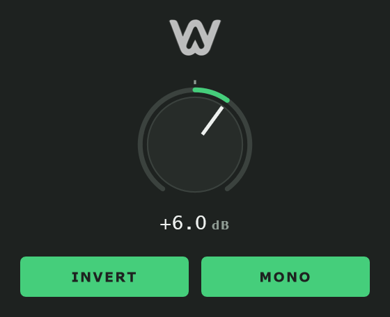

# WA Tool

WA Tool is a small utility plugin for VST3 hosts on Windows, macOS and Linux. It does three
things: trims the output between -24 and +24 dB, flips the polarity of both channels, and
folds stereo down to mono.

The reason it exists is the clicks. Most DAWs ship a free gain or utility device, but
automating its polarity or mono button over a loud signal produces an audible pop. Every
control here is ramped over 10 to 20 ms, so the switches can be flipped while audio is
playing.



## Download

Grab the latest build from the [Releases](https://github.com/hyperphonia/wa-tool/releases/latest)
page. Each archive contains the VST3 and a standalone version, so it can be tested without a DAW.

On Windows, copy the `.vst3` folder into `C:\Program Files\Common Files\VST3`.
On macOS, copy it into `~/Library/Audio/Plug-Ins/VST3`.
On Linux, copy it into `~/.vst3`.

There is no installer, no telemetry and no account.

## Controls

The knob is the output gain. Double-click it to return to 0 dB. The arc grows outward from
the 0 dB mark, so a cut reads counter-clockwise and a boost clockwise.

INVERT flips the polarity of both channels.

MONO sums the two channels with a factor of 0.5, so a correlated stereo signal keeps its level.

All three controls are automatable, and they are saved with the session.

Signal order is fixed: mono fold, then gain, then polarity. Gain and polarity commute, so the
order only matters against the mono fold.

## Building

You need CMake 3.22 or newer, and a C++17 compiler. JUCE 8.0.15 is downloaded on the first
configure, so expect a few minutes before the first build finishes.

```bash
cmake -B build -DCMAKE_BUILD_TYPE=Release
cmake --build build --config Release --parallel
```

The VST3 and the standalone binary end up in `build/Tool_artefacts/Release/`.

If you already have a JUCE checkout, put it at `libs/JUCE` and the build will use it instead of
downloading another copy.

### Development targets

Two optional targets are available and both are off by default.

`ToolTests` runs the DSP assertions offline:

```bash
cmake -B build -DTOOL_BUILD_TESTS=ON
cmake --build build --config Release --target ToolTests
./build/ToolTests_artefacts/Release/ToolTests
```

`ToolShots` renders the editor at 2x into `screenshots/`. The image above comes from it, which
means a UI change can be reviewed without opening a DAW:

```bash
cmake -B build -DTOOL_BUILD_SHOTS=ON
cmake --build build --config Release --target ToolShots
./build/ToolShots_artefacts/Release/ToolShots
```

## Layout support

The plugin accepts mono to mono and stereo to stereo. Other configurations are rejected rather
than silently routed the wrong way.

## License

[GPL-3.0](./LICENSE).

JUCE 8's free tier requires a GPL-compatible license, so the plugin inherits it. A commercial
JUCE license removes the constraint.
